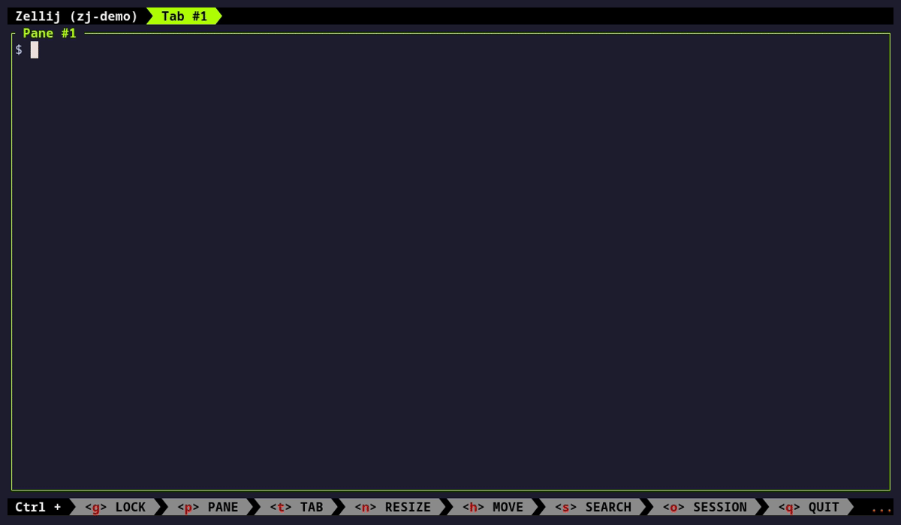

# zj-cmd



Two small shell scripts that give [zellij](https://zellij.dev) a tmux-style command prompt and a keybinding cheat sheet, each in a floating pane.

Neither keeps its own list of commands or keys. Both read what your zellij install and config provide, so they stay current when zellij adds actions or you change bindings.

| Script | What it shows | Where the data comes from |
|---|---|---|
| `zj-cmd` | fzf over every `zellij action`, with that action's `--help` as a preview. Pick one, edit the arguments, Enter. | `zellij action --help` |
| `zj-keybinds` | Your keybindings grouped by mode, your comments shown dimmed, plus zellij's defaults for the modes you choose. | The config file zellij loads (`zellij setup --check`) and `zellij setup --dump-config` |

## Requirements

- zellij 0.44 or later (older versions may work; untested)
- bash, awk, less
- [fzf](https://github.com/junegunn/fzf) for `zj-cmd`

## Install

Put both scripts on the `PATH` that zellij sees:

```sh
git clone https://github.com/tzeitim/zj-cmd.git ~/src/zj-cmd
ln -s ~/src/zj-cmd/bin/zj-cmd ~/src/zj-cmd/bin/zj-keybinds ~/.local/bin/
```

Bind them in your `config.kdl`. This works with any setup: `Alt x` opens the command prompt and `Alt /` the cheat sheet, from every mode except Locked. Neither key is taken by zellij's defaults.

```kdl
keybinds {
    shared_except "locked" {
        bind "Alt x" { Run "zj-cmd" { floating true; close_on_exit true; name "zellij action"; }; SwitchToMode "Normal"; }
        bind "Alt /" { Run "zj-keybinds" { floating true; close_on_exit true; name "keybinds"; }; SwitchToMode "Normal"; }
    }
}
```

If you use zellij's tmux mode (`Ctrl b`) as a prefix, you can bind them tmux-style instead, as prefix `:` and prefix `?`:

```kdl
keybinds {
    tmux {
        bind ":" { Run "zj-cmd" { floating true; close_on_exit true; name "zellij action"; }; SwitchToMode "Normal"; }
        bind "?" { Run "zj-keybinds" { floating true; close_on_exit true; name "keybinds"; }; SwitchToMode "Normal"; }
    }
}
```

If zellij can't find the scripts, use the absolute path in `Run`. zellij uses the `PATH` of the shell that started the session.

## Usage

**`zj-cmd`**
- Type to filter the actions. The preview shows the selected action's options.
- Enter puts the action on an editable line, for example `zellij action rename-tab ` waiting for the name.
- The floating pane hides itself before running, so `close-pane`, `new-pane` and similar act on the pane you came from.
- If the action prints anything, such as `query-tab-names` or an error, the output opens in a floating `less`. Actions that only return the ID of what they created, like `new-pane`, don't open one.
- `zj-cmd --list` prints the action list without fzf.

**`zj-keybinds`**
- `q` closes it. `/` searches.
- `ZJ_KEYBINDS_DEFAULT_MODES="tab scroll"` (the default) picks which modes get zellij's default bindings appended. Set it to empty to skip them. They're skipped anyway when your config uses `keybinds clear-defaults=true`.
- `ZJ_KEYBINDS_CONFIG=path` reads a different config file.
- When piped, it prints plain text instead of opening `less`.

## Known limits

- Running a `zj-cmd` action also hides any other floating panes that were open.
- `zj-keybinds` reads KDL line by line, not with a full parser. It expects one `bind` per line and the 4-space indentation zellij writes. Unusual formatting may show up oddly.
- Descriptions come straight from `zellij action --help`, mistakes included.

## Demo GIF

Recorded with [VHS](https://github.com/charmbracelet/vhs) in a throwaway session with its own config: `vhs demo/demo.tape`

## Test

```sh
bash tests/check.sh
```

The test runs against your installed zellij.

## License

MIT
